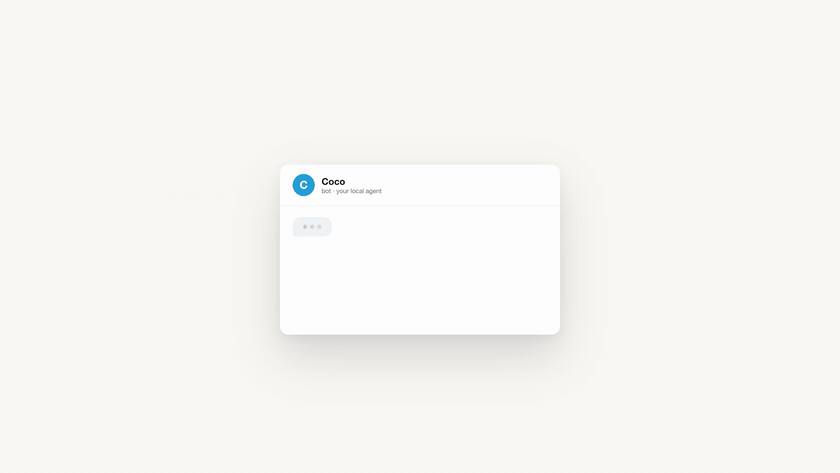

# Coco - personal assistant



Coco is a local-first AI agent that drives your real browser end to end: you message it on
Telegram, it plans the goal, opens Chrome, clicks and types through the actual UI, pauses for
your approval at sensitive steps (logins, payments, TOTP fields), and reports back in chat.

Everything runs on your machine — the vault, the task ledger, the browser. No cloud runtime
holds your credentials: secrets live in an encrypted local vault, and the LLM key is whatever
provider you point `config.json` at.

## Features

- **End-to-end browser orchestration** — a [browser-use](https://github.com/browser-use/browser-use) + [cloakbrowser](https://github.com/Kaliiiiiiiiii-Vinyzu/cloakbrowser) worker drives a real fingerprint-consistent Chrome over CDP (StealthBrowser / CdpDriver), completing multi-step goals in the live UI.
- **Agent Reach fast path** — for YouTube / social-media data questions, `tools/agent_reach_tool.py` fetches the answer directly (search, subtitles, posts, comments) instead of opening a browser at all. The Telegram router enforces this fast path before spinning up the browser worker.
- **Secure local vault** — Fernet-encrypted SQLite (`vault.db`) for credentials, TOTP seeds and Privacy.com virtual cards. Secrets are injected into tasks only at the moment of use; keys can be entered at the local dashboard instead of any file.
- **Human-in-the-loop gating** — logins, payments and TOTP prompts pause the run and ask you in Telegram (`request_user_credentials`), with approval timeouts enforced in the ledger.
- **Conversational Telegram router** — `telegram_gateway/gateway.js` long-polls your bot, classifies each message, and routes goals to the browser worker, the vault, or the dashboard.
- **Local dashboard & tracker** — a Next.js UI on port 3000 for first-run setup, live tracking, and vault management.

## Requirements

- **Node.js** ≥ 20 and **npm** ≥ 10
- **Python** ≥ 3.10 (two venvs are used: `.venv-bu` for the browser worker, `.venv` for tools)
- **[uv](https://docs.astral.sh/uv/)** — used to create the venv and install pinned Python deps
- A **Telegram bot token** (from [@BotFather](https://t.me/BotFather)) and an **LLM API key** (OpenAI / Anthropic / OpenRouter / Ollama)

## Installation

```sh
git clone https://github.com/priyanshu132008/coco.git
cd coco

# Node deps + build @coco/core and the coco CLI
npm install
npm run build:core
sh build.sh            # bundles dist/coco.js (used by `npm i -g` or direct node)

# Python deps for the browser worker + tools
uv venv .venv-bu && uv venv .venv
uv pip install -r tools/requirements.txt --python .venv-bu/bin/python

# Secrets: copy the template and fill in what you use
cp .env.example .env   # then add TELEGRAM_BOT_TOKEN + your LLM key
```

Prefer the dashboard? `coco configure` walks through everything in the browser instead of
editing `.env` by hand.

## CLI commands

| Command | What it does |
|---|---|
| `coco configure` | Boots the local dashboard (**http://localhost:3000**) and opens the setup page — enter the bot token + LLM key once |
| `coco online` | Runs the **foreground Telegram bot** and the browser worker — this is the always-on "Coco is listening" mode (Ctrl-C or type `stop` in that terminal to quit) |
| `coco stop` | Kills the whole stack cleanly: gateway, browser/agent workers, and the dashboard on :3000 (also boots out any launchd twin so it doesn't respawn) |
| `coco health` | Checks `.env`, the vault key, SQLite files and keys; prints fixes |
| `coco run "<prompt>"` | One-shot: attaches to your real Chrome (CDP :9222) and runs the model loop |
| `coco serve` | Legacy WebSocket bridge (EXECUTE_INTENT protocol) on ws://localhost:8080 |
| `coco help` | Command list |

## Usage

Everything below is just prompts — send them to your bot on Telegram (or run `coco run "…"`).

```text
Log into Gmail and summarize my unread emails
Search YouTube for "local AI browser agent" and list the top 3 videos
Find the cheapest flight Delhi → Bangalore next weekend and show me the options
Buy a $5 gift card — use my Privacy.com card from the vault
Generate a TOTP code for GitHub and approve the login
```

Sensitive steps (entering credentials, confirming a payment, typing a TOTP) pause the run and
ask you, so the agent never spends or unlocks anything unattended.
